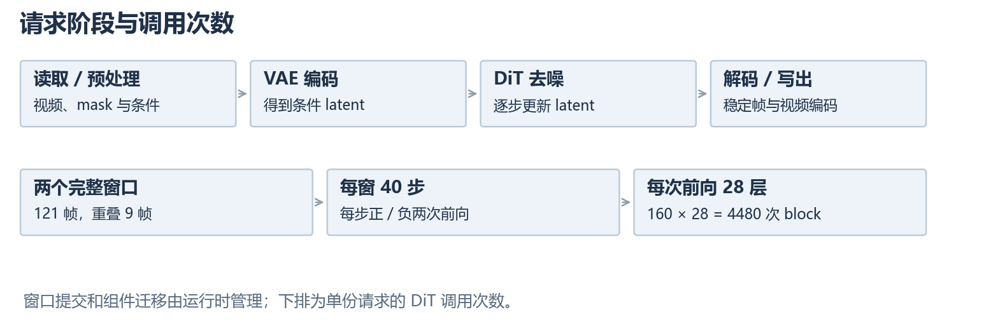
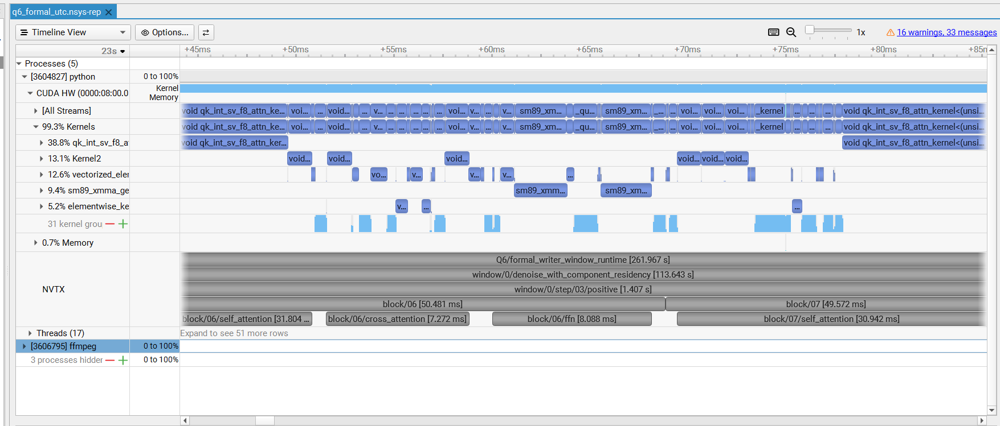
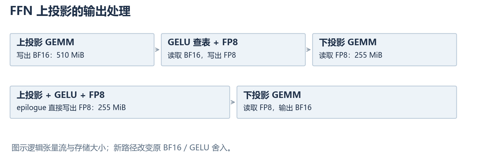

# EraserDiT 单卡推理优化记录

这次优化从已有的 Q6 配置开始：Self-attention 使用 SageAttention，FFN 使用静态 FP8，QK Norm/RoPE、AdaLN 和门控残差已经融合。CPU 侧沿用上一轮 S4 的读取、缓存和数据处理设置。相同输入下，一次完整请求约 264 秒，其中 DiT 去噪约 227 秒。

后续工作主要围绕 DiT 展开。最初的 profiler 同时指向了几类开销：Sage 主核、Cross-attention 中的 Query Norm，以及散布在分配路径里的填充。几个方向都做了尝试，收益差别很大。

实验使用一张 L40S，输入为 1920×1080、145 帧视频，固定 mask、提示词和 seed。窗口长度 121 帧，重叠 9 帧，两个窗口都完整补齐；每窗实际去噪 40 步，CFG 为 3。任务显存目标为 24 GiB，PyTorch allocator 限额为 22 GiB。文中的请求时间均不含加载和预热。

项目此前已经对self-attention等这些明显时间开销占比大的部分进行了量化并做了算子融合，这一轮优化主要是对此前的优化进行补充，主要目的是在这次优化中熟悉推理优化的工作流程和熟悉项目，因此本文档的进行将以profiler性能分析的结果为指引进行推进。

## 1.EraserDiT的代码目录与总体架构

1.代码目录与修改维护
EraserDit的主要代码如下，依赖方向影响可维护性。例如 config 描述选择和约束，不直接构造模型；通用窗口 runtime 不应反向依赖具体模型 stage。这样局部修改可以通过稳定接口接入。仓库已有架构检查测试，这是继承的工程基础。

| 位置 | 主要职责 |
| --- | --- |
| `entrypoints/cli`、`entrypoints/server` | 请求进入推理的入口，本次优化在后续修改中将新增优化配置的入口放在了scripts里  |
| `config`、`scripts` | 实验预设配置与 benchmark，新增优化以接口形式放在scripts中，默认关闭 | 
| `pipelines/session.py` | 使用session.py启动一次常驻推理生命周期 | 
| `pipelines`、`pipelines/stages` | 组件装配、编码/去噪/解码 |
| `pipelines/runtime` | 窗口、缓存、对象调度和帧提交 | 
| `models` | 存放原始DiT、VAE等模型的位置  |
| `layers` | Attention 后端、量化与融合算子 | 
| `loader`、`memory` | 加载、驻留、卸载与迁移 |
| `parallel`、`distributed` | 并行策略与通信 | 


2.总体架构
一次请求包括视频读取与预处理、VAE 编码、DiT 去噪、解码和写出。组件卸载负责控制各阶段的权重驻留，窗口机制限制一次处理的视频长度。



实际捕获的 latent 为 `[1,128,16,34,60]`，投影后特征为 `[1,32640,2048]`。两个窗口，每窗 40 步，每步正负 CFG 各一次，共 160 次 DiT 前向。模型有 28 层，因此一份请求会执行 4480 次 block。

这里有两个值得关注的点：
首先是各阶段的调用次数，在实际优化中，即使只在每个block中进行一次算子融合，每个block省下 1 ms，最终在整个请求中也能够节省约4s左右的时间。

其次是注意到latent是一个相当大的张量，BF16精度下的[1,32640,2048]大小在进入FFN前就已经达到了约120Mib了，在经过FFN拓展将2048维拓张到8192维后大小更是达到了510Mib。即使只在FFN进行数次读写也可能会造成客观的性能影响。

因此在观察总体架构后，可以找出两个潜在的优化方向，一是在block或其他调用次数多的模块内寻找可能的融合机会，二是关注latent在整个流程中的传递，尽可能减少对这个超大tensor的读写次数。在实际优化过程中也可以看到，调用频繁说明收益能够累积，单次数据量决定了这次操作是否值得融合。同样是一次 RMSNorm，视频 Query 和文本 Key 的成本相差很大。

## 2. S3 → Q6：从 profiler 看此前的改动

本轮优化以Q6为基础，但为了方便理解，可以先对更早的S3的profile进行分析。S3已有 QK/RoPE、AdaLN 调制的部分融合，归一化中仍保留原生计算。Q6 则使用静态 FP8 FFN、Sage Self-attention，以及覆盖更完整的 fast QK Norm/RoPE、Norm/AdaLN 和门控残差融合。

### 2.1 S3 profile 分析

```text
-------------------------------------------------------  ------------  ------------  ------------  ------------  ------------  ------------  ------------  ------------  ------------  ------------  
                                                   Name    Self CPU %      Self CPU   CPU total %     CPU total  CPU time avg     Self CUDA   Self CUDA %    CUDA total  CUDA time avg    # of Calls  
-------------------------------------------------------  ------------  ------------  ------------  ------------  ------------  ------------  ------------  ------------  ------------  ------------  
                                           Unrecognized        83.51%       11.284s        83.51%       11.284s       1.188ms        7.899s        58.87%        7.899s     831.412us          9501  
                         aten::_flash_attention_forward         0.03%       3.930ms         1.05%     142.152ms     846.142us        5.995s        44.68%        9.828s      58.498ms           168  
void pytorch_flash::flash_fwd_kernel<pytorch_flash::...         0.00%       0.000us         0.00%       0.000us       0.000us        5.995s        44.68%        5.995s      35.682ms           168  
                                            aten::addmm         1.77%     239.548ms        14.74%        1.992s       1.161ms        2.803s        20.89%        4.689s       2.732ms          1716  
                                denoise_step_2/negative         0.00%       0.000us         0.00%       0.000us       0.000us        2.276s        16.96%        2.276s        2.276s             1  
                                denoise_step_4/positive         0.00%       0.000us         0.00%       0.000us       0.000us        2.243s        16.72%        2.243s        2.243s             1  
                                denoise_step_3/negative         0.00%       0.000us         0.00%       0.000us       0.000us        2.238s        16.68%        2.238s        2.238s             1  
                                denoise_step_3/positive         0.00%       0.000us         0.00%       0.000us       0.000us        2.238s        16.68%        2.238s        2.238s             1  
                                denoise_step_4/negative         0.00%       0.000us         0.00%       0.000us       0.000us        2.238s        16.68%        2.238s        2.238s             1  
                                denoise_step_2/positive         0.00%       0.000us         0.00%       0.000us       0.000us        2.234s        16.65%        2.234s        2.234s             1  
void cutlass::Kernel2<cutlass_80_tensorop_bf16_s1681...         0.00%       0.000us         0.00%       0.000us       0.000us        2.013s        15.00%        2.013s       1.712ms          1176  
                                            aten::copy_         0.16%      22.269ms        10.34%        1.396s     628.487us        1.054s         7.85%        1.518s     683.337us          2222  
                                              aten::mul         0.27%      37.065ms        35.12%        4.746s       2.313ms     779.838ms         5.81%        1.171s     570.660us          2052  
void cutlass::Kernel2<cutlass_80_tensorop_bf16_s1681...         0.00%       0.000us         0.00%       0.000us       0.000us     779.701ms         5.81%     779.701ms       4.641ms           168  
                                              aten::pow         0.17%      22.593ms        11.13%        1.504s       1.492ms     684.961ms         5.10%        1.182s       1.172ms          1008  
void at::native::vectorized_elementwise_kernel<4, at...         0.00%       0.000us         0.00%       0.000us       0.000us     684.961ms         5.10%     684.961ms     679.525us          1008  
                                            aten::fill_         0.34%      46.211ms        14.80%        2.000s     324.831us     611.107ms         4.55%     856.132ms     139.028us          6158  
void at::native::unrolled_elementwise_kernel<at::nat...         0.00%       0.000us         0.00%       0.000us       0.000us     530.649ms         3.95%     530.649ms     517.202us          1026  
void at::native::vectorized_elementwise_kernel<4, at...         0.00%       0.000us         0.00%       0.000us       0.000us     523.311ms         3.90%     523.311ms     509.057us          1028  
void at::native::elementwise_kernel<128, 4, at::nati...         0.00%       0.000us         0.00%       0.000us       0.000us     449.347ms         3.35%     449.347ms     443.143us          1014  
                                             aten::mean         0.15%      20.107ms         1.73%     233.632ms     231.777us     396.445ms         2.95%     613.178ms     608.312us          1008 
.......
-------------------------------------------------------  ------------  ------------  ------------  ------------  ------------  ------------  ------------  ------------  ------------  ------------  
Self CPU time total: 13.512s
Self CUDA time total: 13.418s

```

表里同时列出了 ATen 算子、CUDA kernel 和模块范围。先从能认出的几项入手：

| S3 中的观察 | 初步判断 | 接下来查什么 |
| --- | --- | --- |
| FlashAttention 主 kernel：168 次、5.995 s | Self-attention 核心是显著热点 | 后端与计算精度是否还有选择，准备数据的代价有多大 |
| `addmm`：1716 次、2.803 s Self CUDA | Linear 也是主要开销 | 区分 FFN、视频投影和文本投影，查看各自矩阵形状 |
| `pow` / `mean`：各 1008 次 | 某类归一化在 block 内重复执行 | 对照调用次数和源码，确定调用来源 |
| `copy_`：2222 次、1.054 s Self CUDA | 转换或复制值得继续追踪 | 查看 dtype、stride 与调用者，判断是CPU还是GPU搬运 |
| `fill_`：6158 次、611.107 ms Self CUDA | 分配和初始化成本 | 确认填充值、分配来源，以及输出是否会被完整覆盖 |

占比最大的是Attention部分。但这里已经执行了 FlashAttention，在Q6中更换为了Sage Attention，该部分已经较为成熟，不一定有继续优化的空间，虽然占比最高但目前不优先考虑优化。

Linear 则需要继续拆。FFN 的两次矩阵乘分别为 `[32640,2048] × [2048,8192]` 和 `[32640,8192] × [8192,2048]`；Self-attention 的 Q/K/V、输出投影，以及 Cross-attention 的投影也会出现在 `addmm` 中。

最值得关注的是`pow` / `mean`这些基础算子的大量调用，这说明流程中仍有相当可观的部分没有被融合。

### 2.2 用调用次数寻找归一化

值得注意的是，`pow` 和 `mean` 的调用次数完全相同。这很有可能是pow和mean操作都属于同一个函数中被同时调用，这基本可以确定是某部分函数没有继续融合，且该部分占时也比较客观。确定有优化空间后，接下来就需要定位这部分调用来自哪个函数。

pow和mean调用次数均为1008次。1008这个调用次数非常值得关注，1008除以168次block，恰好每个block各六次。检查模型，就可以定位到，每个block 6次刚好是一次Transform block中的6次RMSNorm的调用：

```text
norm1 / AdaLN
  → Self-attention：Q Norm、K Norm → Attention → 门控残差
  → Cross-attention：Q Norm、K Norm → Attention → 残差
  → norm2 / AdaLN → FFN → 门控残差
```

`mul` 的 2052 次则不那么典型，除了RMSNorm以外，归一化、残差门控这些地方都会用到乘法，因此目前暂时无法拆出mul的真正来源。

### 2.3 Q6优化后相对S3的变化

```text
------------------------------------------------------------------------------------------------------------------------  ------------  ------------  ------------  ------------  ------------  ------------  ------------  ------------  ------------  ------------  
                                                                                                                    Name    Self CPU %      Self CPU   CPU total %     CPU total  CPU time avg     Self CUDA   Self CUDA %    CUDA total  CUDA time avg    # of Calls  
------------------------------------------------------------------------------------------------------------------------  ------------  ------------  ------------  ------------  ------------  ------------  ------------  ------------  ------------  ------------  
                                                  sageattention_sm89::qk_int8_sv_f8_accum_f32_fuse_v_scale_attn_inst_buf         0.36%      28.024ms         0.42%      32.926ms     195.986us        3.572s        42.82%        3.572s      21.263ms           168  
void qk_int_sv_f8_attn_kernel<128u, 64u, 32u, 64u, 64u, (DataType)1, (QuantGranularity)3, (QuantGranularity)3, float,...         0.00%       0.000us         0.00%       0.000us       0.000us        3.572s        42.82%        3.572s      21.263ms           168  
                                                                                                            Unrecognized        82.51%        6.491s        82.51%        6.491s       1.016ms        1.573s        18.86%        1.573s     246.318us          6386  
                                                                                                             aten::addmm         2.44%     191.995ms        18.60%        1.463s       1.060ms        1.226s        14.70%        1.768s       1.281ms          1380  
void cutlass::Kernel2<cutlass_80_tensorop_bf16_s16816gemm_relu_bf16_256x128_32x3_tn_align8>(cutlass_80_tensorop_bf16_...         0.00%       0.000us         0.00%       0.000us       0.000us        1.216s        14.58%        1.216s       1.206ms          1008  
                                                                                                        aten::_scaled_mm         0.71%      55.874ms         3.71%     292.087ms     869.305us     876.176ms        10.50%        1.318s       3.921ms           336  
sm89_xmma_gemm_e4m3bf16_e4m3f32_f32_tn_n_tilesize128x128x64_stage3_warpsize2x2x1_tensor16x8x32_execute_kernel__5x_cub...         0.00%       0.000us         0.00%       0.000us       0.000us     876.176ms        10.50%     876.176ms       2.608ms           336  
                                                                                                             aten::fill_         0.74%      57.843ms        53.37%        4.199s     572.522us     593.631ms         7.12%     852.479ms     116.237us          7334  
void at::native::vectorized_elementwise_kernel<4, at::native::FillFunctor<c10::BFloat16>, std::array<char*, 1ul> >(in...         0.00%       0.000us         0.00%       0.000us       0.000us     424.819ms         5.09%     424.819ms     156.529us          2714  
                                                                                                                 _kernel         0.00%       0.000us         0.00%       0.000us       0.000us     406.394ms         4.87%     406.394ms     806.337us           504  
                                                                                                       _quant_fp8_static         0.00%       0.000us         0.00%       0.000us       0.000us     254.799ms         3.05%     254.799ms     758.329us           336  
                                                                                                             aten::copy_         0.12%       9.240ms         4.11%     323.104ms     368.000us     218.425ms         2.62%     385.441ms     438.999us           878  
                                                                                                  _gated_residual_kernel         0.00%       0.000us         0.00%       0.000us       0.000us     210.312ms         2.52%     210.312ms     625.927us           336  
                                                                                                               aten::mul         0.17%      13.476ms         2.18%     171.681ms     242.487us     163.905ms         1.96%     256.510ms     362.302us           708  
                                                                                                               aten::pow         0.10%       8.139ms         0.21%      16.856ms      50.166us     137.108ms         1.64%     154.347ms     459.365us           336  
void at::native::vectorized_elementwise_kernel<4, at::native::(anonymous namespace)::pow_tensor_scalar_kernel_impl<fl...         0.00%       0.000us         0.00%       0.000us       0.000us     137.108ms         1.64%     137.108ms     408.058us           336  
                                                                                                              aten::mean         0.17%      13.558ms         3.52%     277.154ms     549.908us     119.830ms         1.44%     181.951ms     361.014us           504
                                                                                                              ......
------------------------------------------------------------------------------------------------------------------------  ------------  ------------  ------------  ------------  ------------  ------------  ------------  ------------  ------------  ------------  
Self CPU time total: 7.868s
Self CUDA time total: 8.342s

```

把两张表中的同名算子和主要 kernel 摘出来，变化会更直观：

| 项目 | S3 | Q6 | 对应变化 |
| --- | ---: | ---: | --- |
| Attention 主 kernel，168 次 | Flash：5.995 s | Sage：3.572 s | Self-attention 更换后端 |
| `addmm` 次数 | 1716 | 1380 | 少了 336 次普通 Linear 路径 |
| `addmm` Self CUDA | 2.803 s | 1.226 s | 部分工作转入 FP8 GEMM|
| `_scaled_mm` 次数 | \ | 336 | 两层 FFN Linear × 168 次 block |
| `_quant_fp8_static` 次数 | \ | 336 | 新增FP8 GEMM 前的激活量化 |
| `pow` 次数 | 1008 | 336 | 四处 Norm 的平方进入融合实现 |
| `mean` 次数 | 1008 | 504 | 四处 Norm 的归约被融合，同时出现 Sage K 均值处理 |
| `mul` 次数 / Self CUDA | 2052 / 779.838 ms | 708 / 163.905 ms | 多条逐元素路径被融合 |
| `copy_` 次数 / Self CUDA | 2222 / 1054 ms | 878 / 218.425 ms | 单独复制或转换减少 |
| `fill_` 次数 / Self CUDA | 6158 / 611.107 ms | 7334 / 593.631 ms | 次数增加，但绝对耗时却减少 |

Attention：主核更快，外围处理也变了。 S3 中的 Flash 主核被 Sage 主核替代，采样中累计时间从约 6 秒降到约 3.6 秒。这支持继续采用低精度 Attention 的性能方向。Sage 还需要 K 均值处理、量化和布局准备，这些工作分散在主核之外。

FFN：减少的 `addmm`，能在新路径中找到对应项。`1716 − 1380 = 336`，恰好对应 168 次 block 中的两层 FFN Linear；Q6 又出现了 336 次 `_scaled_mm`。结合 FFN 量化范围和执行记录，可以确认这部分矩阵乘并未消失，而是改走静态 FP8 W8A8。

Norm 和残差：RMSNorm融合仍有遗漏。Q6 的 fast QK/RoPE 将 Self-attention 的 Q/K RMSNorm 纳入 kernel；fast Norm/AdaLN 又覆盖 block 的 `norm1`、`norm2`。这四处RMSNorm进行了融合，剩下两处Cross-attention中的却遭到了遗漏，因此Cross-attention RMSNorm已经可以确定为下一步的融合方向。门控残差则另有 `_gated_residual_kernel`，336 次对应每个 block 的 Self-attention 后和 FFN 后两次调用；Cross-attention 后的普通残差加法不属于这两次门控残差。

### 2.4  Q6仍存在大量基础算子`pow` 和 `mean`等调用

Q6的`pow`和 `mean`调用次数不同，初看比较迷惑，但Q6 记录了输入形状，将剩余算子按 shape 分组后就很清楚了：

| 算子 | 输入形状 | 次数 | 对应路径 |
| --- | --- | ---: | --- |
| `pow` | `[1,32640,2048]` | 168 | Cross-attention Query Norm |
| `pow` | `[1,128,2048]` | 168 | Cross-attention Key Norm |
| `mean` | `[1,32640,2048]` | 168 | Cross-attention Query Norm |
| `mean` | `[1,128,2048]` | 168 | Cross-attention Key Norm |
| `mean` | `[1,32640,32,64]` | 168 | Sage K 均值处理 |

这样，`pow` 的 336 次和 `mean` 的 504 次就能分别解释，而不必把所有 `mean` 都当成遗漏的 RMSNorm。两处 Cross Norm 虽然调用次数相同，但视频 Query 与文本 Key 的长度差了 255 倍。选优化目标时，次数提供了定位线索，实际数据量和测量时间才决定优先级。

另一个留下来的方向是填充。`fill_` 的时间基本没变，占比却从 4.55% 上升到 7.12%。Q6 trace 已经能沿 `empty_like`、类型转换、`_scaled_mm` 等调用找到填充，后续需要逐处检查哪些缓冲在读取前一定会完整写入。

### 到这里，本轮的两个候选就比较明确了：先检查长 Query 的原生 RMSNorm，再检查分配路径中的填充。Sage 仍是最大单项，但相对较成熟，对外围边界和收益更明确的部分进行优化更合理。

下面的 Nsight 片段展示了两个 Sage 主核之间仍然存在的投影、量化和逐元素处理，可结合profile log进行分析。短条形不一定值得逐个优化；要先认出它属于哪段计算，再结合数据量和调用次数判断。



本节沿用历史采集，没有重新运行 GPU 实验。S3 原表、协议及 Q6 的 shape 分组依据见 [S3→Q6 分析数据](data/s3_q6/README.md)。历史 Q3/Q4/Q5 中还存在跨卡、并行和构建重叠，本文不通过相邻配置的完整请求时间相减来分配单项收益。


## 3.第一处优化：RMSNorm融合逐元素操作

两处Norm 都没有融合，但观察profile可以发现两处Norm 的开销差异非常大。Query 来自视频，有 32640 个位置；Key 来自文本，只有 128 个位置。在这次 Q6 双窗口采样中，Query RMSNorm 占 kernel 累计时间的 7.91%，Cross-attention 的注意力核心反而只占 1.09%。因此，这一轮先处理长Query 上的归一化。

这里的开销区别主要与读取的数据大小有关。Query 读取的视频token BF16 特征已经有 127.5 MiB，转成 FP32 后达到 255 MiB。原生表达式依次执行转换、平方、归约、归一化和权重乘法，中间结果多次写回，再由后一个算子读取，该过程中产生了大量的数据读写。

接下来需要决定融合到哪一步，即确定**实现边界**：整行 RMSNorm 可以写进一个 Triton kernel，但这会引入新的归约实现，求和顺序可能与原来的 PyTorch 路径不同。本轮先保持 Q6 的数值行为，因此保留原生的 FP32 mean、epsilon addition 和 rsqrt，只融合两端的逐元素操作。

归约前将 BF16→FP32 转换与平方合并，省去单独保存转换结果；归约后将归一化与权重乘法合并，同时保留中间的 BF16 舍入。平方结果仍然需要写出，供原生 mean 读取。因此，最终实现为局部RMSNorm 融合，通过保留归约路径保证输出结果一致，通过减少数次大张量的读写节省运行时间。

原实现的计算大致如下：

```python
q32 = q.float()
inverse = torch.rsqrt(q32.square().mean(-1, keepdim=True) + eps)
normalized = (q32 * inverse).to(torch.bfloat16)
out = normalized * weight
```

归约后 kernel 中仍有一次 BF16 转换：

```python
normalized = _mul_rn_f32(value, inverse).to(tl.bfloat16).to(tl.float32)
out = _mul_rn_f32(normalized, weight).to(tl.bfloat16)
```

`normalized` 先舍入到 BF16，再转回 FP32 参与权重乘法，对应原实现的中间结果。若改成 FP32 连乘、最后统一转 BF16，结果可能不同。`_mul_rn_f32` 使用 `mul.rn.f32` 指令约束乘法的舍入方式。

```python
##完整triton融合代码
@triton.jit
def _norm_affine(Q, W, R, O, N: tl.constexpr, WIDTH: tl.constexpr, BLOCK: tl.constexpr):
    index = tl.program_id(0) * BLOCK + tl.arange(0, BLOCK)
    valid = index < N
    value = tl.load(Q + index, valid, 0).to(tl.float32)
    inverse = tl.load(R + index // WIDTH, valid, 0)
    normalized = _mul_rn_f32(value, inverse).to(tl.bfloat16).to(tl.float32)
    weight = tl.load(W + index % WIDTH, valid, 0).to(tl.float32)
    tl.store(O + index, _mul_rn_f32(normalized, weight).to(tl.bfloat16), valid)


def triton_cross_q_rmsnorm_native(query, weight, eps):
    inverse = _inverse_rms(query, eps)
    output = audited_empty_like(query, label='cross_q_output')
    _norm_affine[(triton.cdiv(query.numel(),1024),)](
        query, weight, inverse, output, query.numel(), query.shape[-1], 1024,
        num_warps=4)
    return output
```
``` program_id * BLOCK + arange ``` 划分连续元素；```index // WIDTH ```找行归约结果；```index % WIDTH ```找权重；```valid``` 防止尾块越界。```BLOCK=1024``` 是逻辑元素数，```num_warps=4 ```是线程组织配置。```tl.load/tl.store``` 经编译后才决定具体访存和调度。写融合算子时，先保证索引、舍入、尾部和完整写入，再调 ```BLOCK/warp```。

在局部 trace 测试中，每次调用从 10 个 kernel 减到 7 个，mean kernel 保持不变。使用 CUDA events 测得耗时局部中位数从 **3.996 降到 1.977 ms**。局部节省约 2.019 ms，乘以 4480 次约为 9.05 秒；实际 DiT 只节省约 6.23 秒。在实际优化中，缓存、调度等仍然会造成影响。

完整请求在同一卡上按执行四轮，每轮独立加载和预热。请求均值从 **267.066 降到 258.847 秒，减少 3.08%**，四份编码输出均与原 Q6 一致。局部收益在整片上保留了一部分，这项改动进入后续配置。

[Cross-Q kernel](https://github.com/MGTVAI/EraserDiT/blob/160b974e82d0aa44919184f837e871191f0605d6/layers/operator_fusion/triton/cross_q_rmsnorm.py) · [原生归约](https://github.com/MGTVAI/EraserDiT/blob/160b974e82d0aa44919184f837e871191f0605d6/layers/operator_fusion/triton/rmsnorm_native.py)

## 4. 分配路径中的填充

Cross-Q RMSNorm 融合后，每次调用从 10 个 kernel 减少到 7 个，但局部 trace 中还留着两个 fill kernel。Q6 的整体profile中，`aten::fill_`的开销也不小。单窗口表中，它的累计时间为 593.631 ms，占 7.12%；这些填充分散在多个模块里。

沿着 CPU 调用与 GPU kernel 的关联关系往上查，可以找到几类来源：

```text
empty / empty_like
  └─ fill_

to → _to_copy → empty_strided
  └─ fill_

_scaled_mm → 输出缓冲分配
  └─ fill_
```

其中不少填充值是 NaN。它们不是模型计算需要的零初始化，而与当前的确定性设置有关。

### 为什么 `empty_like` 也会填充

当前配置开启了确定性算法，同时启用了：

```python
torch.utils.deterministic.fill_uninitialized_memory
```

在这组设置下，PyTorch 会对相关未初始化分配填入已知值，例如浮点张量中的 NaN，避免程序读到未初始化内存后产生不确定结果。因此，代码虽然写的是 `empty_like`，实际执行时仍可能出现一次完整的填充。

对于融合 kernel 的输出，可以检查这样的调用：

```python
output = torch.empty_like(query)
fused_kernel(query, output)
```

如果 `fused_kernel` 在后续读取发生前写满 `output`，前面的填充值就不会参与计算。执行过程相当于：

```text
先填满输出缓冲
    → kernel 将输出全部覆盖
    → 后续算子读取
```

第一遍写入便有可能省去。Cross-Q 的输出是 127.5 MiB，平方结果是 255 MiB，这类填充即使计算简单，也需要处理相当大的数据量。

### 缩小修改范围

这轮没有全局关闭确定性算法，而是检查了几个具体位置：融合输出、量化输出，以及静态 FP8 GEMM 的相关分配。对于确认符合条件的调用，在短作用域内关闭未初始化内存填充，完成后恢复设置。

控制方式如下，省略了正式实现中的检查和计数：

```python
previous = torch.utils.deterministic.fill_uninitialized_memory
try:
    torch.utils.deterministic.fill_uninitialized_memory = False
    run_audited_operation()
finally:
    torch.utils.deterministic.fill_uninitialized_memory = previous
```

这里改变的是分配时的填充行为，`deterministic_algorithms` 仍保持开启。

验证分成两部分。先检查源码，确认输出的写入范围；再对可控制的分配分别预填零和 NaN，观察结果是否受旧内容影响。

### trace 中减少了什么

修改前后，局部 trace 的变化很直接：

| 路径 | 保留填充 | 定点跳过填充 |
| --- | ---: | ---: |
| Cross-Q RMSNorm | 7 个 kernel | 5 个 kernel |
| FFN 上投影 | 6 个 kernel | 2 个 kernel |

非填充 kernel 的名称和次数保持不变。这与预期一致：这次没有更换计算算法，减少的是计算前的初始化写入。

在同一张卡上进行 A→B→B→A 完整请求对照。请求均值从 **257.666 秒降到 249.886 秒，减少 3.02%**，输出一致。

这次排查还说明，融合 kernel 本身之外的分配值得一起看。算术操作减少后，如果输出仍在计算前被完整填充一次，大张量的额外写入就会继续留在 trace 中。定位到具体分配、确认覆盖关系，再决定是否省去填充，比直接关掉全局开关更容易解释和维护。

[分配作用域](https://github.com/MGTVAI/EraserDiT/blob/160b974e82d0aa44919184f837e871191f0605d6/layers/audited_allocations.py) · [PyTorch 确定性填充说明](https://docs.pytorch.org/docs/2.6/deterministic.html)

## 5. 几项收益较小的尝试

前两项改动都减少了大张量的重复写入。沿着这个方向，还能找到一些看起来合理的候选：把相邻算子继续融合，提前统一输入精度，或者缓存步骤间不变的文本条件。这些候选也做了测试，但局部开销减少后，完整请求不一定有足够收益。

### AdaLN 与 FP8 量化：局部变快，整片变化不大

FFN 已经使用静态 FP8，但进入 FFN 前仍有两步独立操作：

```text
Norm / AdaLN → 写出 BF16 特征
FP8 量化    → 读取 BF16 特征 → 写出 FP8 特征
```

两步处理的是同一份 `[1,32640,2048]` 特征。将量化放进 AdaLN 的输出端，可以省去中间 BF16 张量的写出与读取。

此外，Linear 也需要接收已经量化的输入，否则进入原来的 FP8 Linear 后还会再量化一次。因此修改涵盖了Linear和预量化输入的传递和分派。

局部测试中，耗时从 **0.7079 ms 降到 0.3132 ms**，减少了一半以上。但完整请求只从 **249.716 秒降到 248.816 秒，减少约 0.36%**。局部加速比很大，是因为比较的对象本来就只有不到一毫秒。按 4480 次 block 粗略外推，节省约 1.77 秒；完整请求实测却只省 0.90 秒。

与此前 Cross-Q RMSNorm 融合相比，起点也不同：
- Cross-Q 原本包含多步分散的转换、平方、归约和乘法，有较多中间结果可以消除。
- AdaLN 原本已经融合好了，这次只是再接上 FP8 量化，计算 kernel 从 2 个减到 1 个，剩余空间更小。

这项改动增加了 Linear 接口和输入状态的处理，却只换来较小的请求收益，因此没有纳入最终组合。

### 输入精度转换：确实存在绕路，但发生次数少

输入投影前还有一处精度变化：

```text
当前 latent：BF16
cond_latents、mask_values：FP32
    → 拼接得到 FP32
    → autocast 下的 Linear 转为 BF16
```

这条路径有理由检查：既然后面以 BF16 进入 Linear，能否提前统一精度，减少拼接和转换的数据量？

局部测试中，相关路径从 **0.81256 ms 降到 0.75546 ms**，单次只减少约 **0.057 ms**。

它与 block 内的归一化不同，只在每次 DiT 前向的输入处执行一次。整份请求有 160 次前向，按局部差值估算：

```text
0.0571 ms × 160 ≈ 9.1 ms
```

理论上只有9.1ms的加速，还没算上新增缓存对总体流程的影响，因此最终没有纳入主分支中。这处转换不仅本身空间小，调用次数更少，即使进行优化最后得到的结果也只有毫秒级的变化。

### 文本投影与 KV 缓存：命中了缓存，也未必更快

同一份请求中，文本条件在去噪步骤之间保持不变。Cross-attention 的文本投影与 K/V 因而具有复用机会，项目也已经提供了相应缓存路径，可以直接做启用前后的对照。

实验确认缓存实际命中，输出也保持一致，但完整请求从 **248.411 秒变为 249.403 秒**，这组对照中反而慢了约 **0.40%**。

回看 profile，这个结果并不难理解：文本只有 128 个位置，视频 Query 有 32640 个位置。Q6中，文本 K/V 投影与 K Norm 合计仅占 kernel 累计时间的约 **0.15%**，可节省的计算本来就有限。缓存还涉及查找、分支区分、生命周期与失效管理，最终反而增加了总体开销，因此最终也没有纳入主分支中。

这些结果也改变了后续筛选方式。发现候选后，先看单次开销和完整请求中的调用次数，再决定是否值得做更深入的实现。对于需要新增接口、缓存状态或专用分支的改动，还要考虑这部分代码是否值得长期维护。

## 6. 从逐元素融合到 FP8 数据路径

前几轮主要在减少重复读写，同时尽量保持 Q6 原来的数值行为。Cross-Q 和定点填充获得了收益，但继续往已有融合后面接一个算子，收益开始变小。AdaLN→FP8 就是例子：局部时间减少一半以上，完整请求只减少约 0.36%。

因此接下来我们将注意力转向量化相关方向：一处是已经使用 FP8 的 FFN，检查低精度 GEMM 之间是否仍有不必要的转换；另一处是尚未量化的 Self-attention QKV 投影，尝试扩大 FP8 的使用范围。

| 候选 | 选择理由 | 本次修改的边界 |
| --- | --- | --- |
| FFN 上投影输出端 | 8192 维中间特征占 510 MiB，写成 BF16 后马上又要量化 | 保留已有 FP8 权重和输入量化，将 GELU 与 FP8 输出接入 GEMM epilogue |
| Self-attention QKV | 原 Q6 中仍是 BF16 Linear，占采样 kernel 累计时间的 7.29%；三路输入相同 | 只替换 Q/K/V 投影，输出仍为 BF16，后续 Norm、RoPE 和 Sage 配置不变 |

### 6.1 FFN 上投影输出端

FFN 的两层 Linear 分别将特征从 2048 扩张到 8192，再收缩回 2048。原 Q6 已将 GELU 查表和 FP8 量化合并，但上投影仍先输出 BF16：

```text
FP8 上投影 GEMM + bias
    → BF16 中间特征 [32640,8192]
    → GELU 查表 + 静态 FP8 量化
    → FP8 下投影 GEMM + bias
    → BF16 输出 [32640,2048]
```

中间 BF16 张量有 510 MiB，刚写完就被下一个 kernel 读入。因此改进思路是让上投影在输出阶段直接完成 GELU 和 FP8 转换，交给下投影使用。



这里省掉的是一份 BF16 中间结果的写出和读取，按逻辑张量大小计算合计约 1020 MiB。

### 6.2 用 epilogue 直接得到下一层需要的格式

GEMM 的 epilogue 是矩阵乘结果写出前的处理阶段，可以在这里接入 bias、激活和输出转换。本次使用 cuBLASLt 的 `CUBLASLT_EPILOGUE_GELU_BIAS`，并将输出 D 的类型设为 E4M3。

原 FFN 使用固定激活 scale `s = 0.125`。沿用这一约定，量化与数值恢复可以写成：

```text
u8 ≈ E4M3(clamp(GELU(z) / s, -448, 448))
u  ≈ s × u8

s = 0.125，因此输出量化倍率为 1/s = 8
```

E4M3 的有限值范围上限是 448，这个 scale 对应的激活范围约为 ±56。实际适配中，`D_SCALE_POINTER` 指向倍率 8，下投影则继续使用激活 scale 0.125。

```cpp
cublasLtEpilogue_t ep = mode == 0 ? CUBLASLT_EPILOGUE_BIAS
                                : CUBLASLT_EPILOGUE_GELU_BIAS;
if (mode == 2) CK(cublasLtMatmulDescSetAttribute(
    p->op, CUBLASLT_MATMUL_DESC_D_SCALE_POINTER, &sd, sizeof(sd)));
```

FFN 的入口仍接收 BF16，使用原有静态量化进入上投影。上、下投影权重和 scale 沿用已有方案；本次改变的是上投影结果到下投影输入之间的处理。原流程先把 GEMM 输出舍入到 BF16，再使用 BF16 GELU 查表，最后量化；新流程在库内执行 GELU 并直接输出 FP8。因此，它属于近似方案。

### 6.3 局部与完整trace确认

局部筛选不仅测试了直接 FP8 输出，也测试过 GELU epilogue 输出 BF16、再单独量化的版本：

| 方案 | 上投影至量化输出 / ms | 包含下投影 / ms |
| --- | ---: | ---: |
| 原路径 | 4.072 | 6.882 |
| GELU epilogue → BF16，再量化 | 5.919 | 8.660 |
| GELU epilogue → FP8 直接输出 | 2.952 | 5.711 |

BF16 输出版本虽然成功设置了 epilogue，trace 却显示库额外启动了 `globalKernel` 做后处理，上投影段实际变成三个 kernel，反而更慢。直接 FP8 输出的版本才将原来的上投影、GELU/量化两核变成一核，局部 FFN 的计算 kernel 从三个减到两个。因此，接口提供某种融合能力，并不保证当前形状、精度和算法选择下真的减少了 kernel。这里真正有效的是让上投影直接产生下投影所需的数据格式。

直接 FP8 版本的局部 FFN 耗时减少约 **17%**。随后完整对照中，请求从 **248.742 秒降到 243.807 秒，减少 1.984%**。

需要注意的是显存峰值从 **21.189 升到 22.732 GiB**。虽然融合省去了上投影 BF16 中间结果，但完整请求的显存峰值反而上升。进一步检查发现，活跃分配峰值仅增加约 32 MiB；主要增量来自 PyTorch 保留显存。如果在窗口中增加一次显存释放可能引入额外耗时，且目前显存峰值还没有超过24GB的限制，因此显存部分暂时不做更多操作。

[FFN Python 接入](https://github.com/MGTVAI/EraserDiT/blob/160b974e82d0aa44919184f837e871191f0605d6/layers/quantization/ffn_epilogue.py) · [cuBLASLt 适配](https://github.com/MGTVAI/EraserDiT/blob/160b974e82d0aa44919184f837e871191f0605d6/layers/quantization/csrc/ffn_epilogue.cpp)

### 6.4 QKV投影FP8量化

另一个候选来自 Self-attention。原 Q6 的数据流中，Q/K/V 投影仍是 BF16 Linear，之后经过 Norm、RoPE 和布局处理，才进入 Sage 的量化及 Attention 计算。

```text
BF16 输入 X
    → 三次 BF16 Linear：Q、K、V
    → Norm / RoPE / 布局处理
    → Sage 的量化与 Attention
```

最初的 profile 中，这三次投影占 kernel 累计时间的 **7.29%**，每次都处理 32640 个视频 token，此外三路还共享同一个输入，量化一次 X 就可以供三个 GEMM 使用，而不必分别量化三遍，因此这部分是一个很好的量化实现点。

### 6.5 scale确定与三路共享

这里使用 E4M3 格式和标量 scale。约定 `s` 表示将 FP8 值恢复到原数值量级时的乘数，简化计算如下：

```text
X8 = E4M3(clamp(X / sX, -448, 448))
W8 = E4M3(clamp(W / sW, -448, 448))
Y  ≈ BF16((sX × sW) × (X8 @ W8.T) + bias)
```

权重固定，可以在准备阶段一次性计算每个矩阵的 `amax / 448` 并打包。Q、K、V 各自使用一个权重 scale；输入则在同一个 block 内共享一个激活 scale。

```python
# 数据流示意：一次激活量化，三个独立 GEMM。
x8 = quantize_fp8(x, activation_scale)
q = fp8_mm(x8, wq8, activation_scale, wq_scale)
k = fp8_mm(x8, wk8, activation_scale, wk_scale)
v = fp8_mm(x8, wv8, activation_scale, wv_scale)
```

激活随层、去噪步骤和输入变化，不能照搬 FFN 的固定 scale 0.125。最终校准覆盖全部 28 层、两个窗口、40 步和正负 CFG 分支，共 4480 次输入统计。偶数步用于校准，奇数步留出，每层各有 80 份校准和 80 份留出输入。

```text
每层 sX = 该层校准输入的最大绝对值 × 1.05 / 448
```

scale 以 FP32 保存，额外留出 5% 范围。正式推理直接使用固定值，不再每次计算 amax。代价是遇到分布变化时可能裁剪；放大 scale 虽然能覆盖更多输入，也会改变原数值域中的量化间隔，并不是余量越大越好。


### 6.6 转换指令和模型生命周期

QKV 的激活量化没有直接沿用 FFN 的速度优先转换，而是显式使用 RN 转换。实际 Triton kernel 先除以 scale、裁剪，再调用：

```python
packed = tl.inline_asm_elementwise(
    "cvt.rn.satfinite.e4m3x2.f32 $0, 0.0, $1;",
    constraints="=h,f", args=[q],
    dtype=tl.uint16, is_pure=True, pack=1)
q8 = packed.to(tl.uint8).to(tl.float8e4nv, bitcast=True)
```

这段转换明确了 round-to-nearest 和有限值饱和行为，也避免该路径先转 FP16、再转 E4M3 的双重舍入。

安装新模块时，FP8 权重、scale 和 bias 注册为 module buffers，并在组件卸载 hooks 枚举之前完成替换，使这些缓冲随整个 DiT 上下线。原 BF16 QKV 权重不再长期保留，两份权重不会同时驻留。28 层共替换 84 个 Linear，权重存储从 672 MiB 降到 336 MiB。

### 6.7 完整收益与质量边界

QKV 的同期完整 ABBA 对照中，请求从 **246.452 秒降到 239.303 秒，减少 2.901%**；DiT 从 **207.944 秒降到 201.072 秒，减少 3.305%**。正式计时没有附加校准统计或 profiler。

候选输出与 BF16 QKV 参考不同：全帧 PSNR 为 **43.508 dB**，半分辨率亮度 SSIM 为 **0.990361**。

Self-attention 输出投影也测试过 FP8。局部耗时减少约 18%–23%，但按调用次数估算，请求只可能节省约 0.43%–0.59%；全层统计还有四层的部分留出输入超出校准范围。考虑到收益量级，这项停在局部原型，没有继续完整视频接入。QKV 的结果不能直接推广到相邻的输出投影。

最终进入 Q6c 的是 FFN 输出融合和全 28 层 QKV FP8，两者都保持显式启用。它们的单项实验使用不同的同期基线，且历史实验包含后来移除的 AdaLN→FP8，不能把百分比相加作为组合收益；下一节使用整合后的独立测量。

[QKV FP8 与模型转换](https://github.com/MGTVAI/EraserDiT/blob/160b974e82d0aa44919184f837e871191f0605d6/layers/quantization/qkv_fp8.py)


## 整合后的完整请求

| 配置 | 累计内容 | 请求 / s | DiT / s | NVML 峰值 / GiB |
| --- | --- | ---: | ---: | ---: |
| Q6a | 原 Q6＋S4＋Cross-Q 部分融合＋Sage 外围融合 | 255.923 | 218.840 | 21.189 |
| Q6b | Q6a＋定点减少填充 | 247.145 | 209.053 | 21.189 |
| Q6c | Q6b＋28 层 QKV FP8＋FFN 输出融合 | 235.792 | 197.907 | 22.400 |

Q6a/b 的编码输出与继承 Q6 一致。Q6c 相对 Q6b 的 PSNR 为 43.487 dB、半分辨率亮度 SSIM 为 0.990313，主观PSNR下降不多，可以按需启用。

## 代码与测量记录

本文使用 2026-10-20 至 23 日的已有实验，未为写作重新测速。实现链接固定到提交 `160b974e82d0aa44919184f837e871191f0605d6`。环境为 PyTorch 2.6.0+cu126，Sage 版本为 `eb615cf6cf4d221338033340ee2de1c37fbdba4a`。图的数据、输入协议和结果索引见[测量记录](data/README.md)。

从对应提交的仓库根运行，按安装位置设置 Sage 和 FFN 库路径，使用新的运行目录：

```bash
export MGERASE_Q6_FFN_LIBRARY=/path/to/ffn_epilogue.so
uv run --no-project python scripts/q6_benchmark.py \
  --profile q6c --devices 0 --cache off --repeats 1 \
  --sage-source /path/to/validated/SageAttention \
  --run-dir results/worklog_reproduction_01
```

构建方式见 [Q6 配置文档](https://github.com/MGTVAI/EraserDiT/blob/160b974e82d0aa44919184f837e871191f0605d6/docs/q6_presets.md)。新增扩展当前覆盖单进程主线程、SM89 eager 推理和已验证形状，多卡及并发服务需要另外适配。

